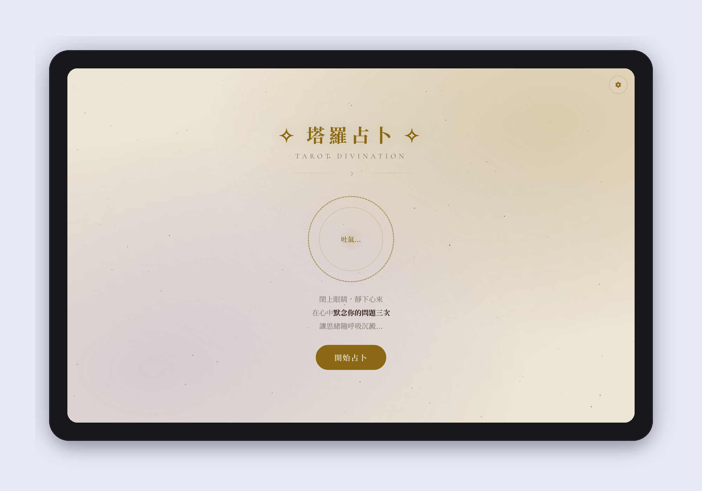

<p align="center">
  
</p>

<p align="center">
  A Traditional Chinese tarot web app that predicts your mind.
</p>

This web app walks you through a Traditional Chinese tarot reading.
You sit with a question, draw cards, and receive an AI interpretation
in Traditional Chinese. After the full reading, the last two paragraphs
become follow-up questions you can tap for one final supplement. Then
the app welcomes you to come back and ask about something else.

<p align="center">
  
</p>

<p align="center">
  
</p>

The app is a single `index.html` file you can open in a browser. An optional
LLM API key (OpenAI, Anthropic, OpenRouter, or a custom OpenAI-compatible
endpoint) is entered in the in-app gear menu and stored only in this browser's
`localStorage` on your device. If no key is saved, the app can fall back to
Poe when that environment is available. This repository does not contain any
API keys.

Follow these steps to run it yourself:

### 1. Open the app

Open `index.html` in a browser, or serve the folder locally:

```bash
python3 -m http.server 8765 --bind 127.0.0.1
```

Then visit `http://127.0.0.1:8765/`.

### 2. (Optional) Add an LLM API key

Open **API 設定** (the gold gear in the corner) and enter your key there.
Do not paste keys into this README, into chat, or into any file you commit.

### 3. Start a reading

Choose 塔羅占卜, 今日運程, or 本週星座運勢, draw your cards, and read the
result. Tap one of the two recommended questions under the reading for a
final extra interpretation, then start again with 重新占卜.

## License

Personal project. Use and modify as you like.
